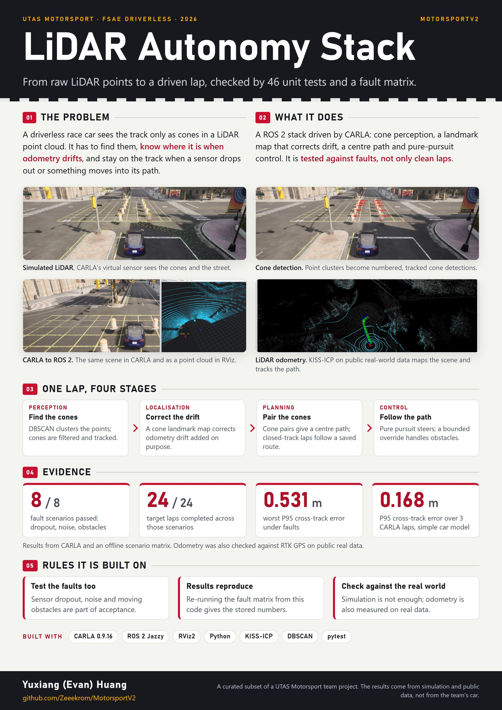
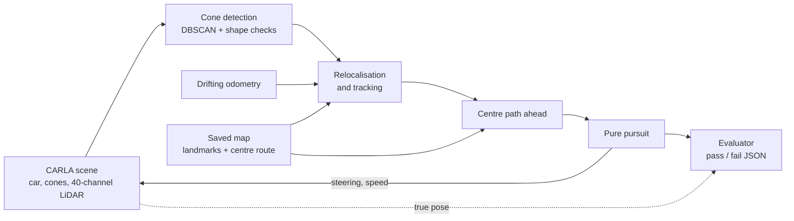
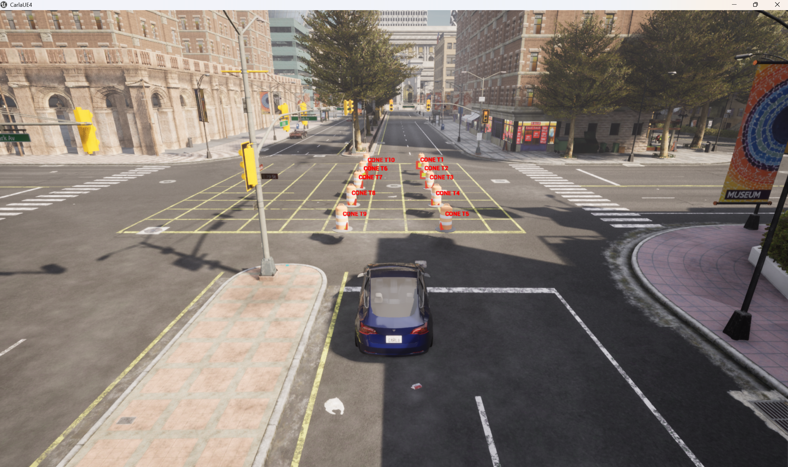
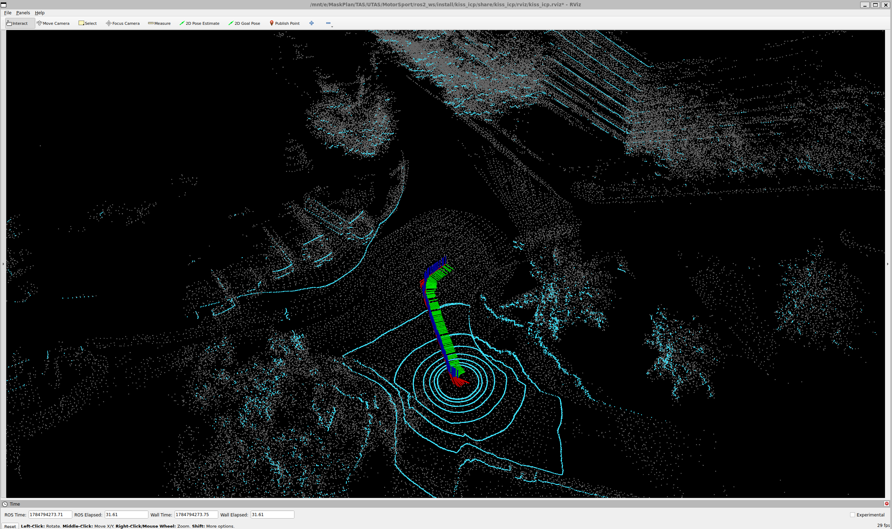

# MotorSport LiDAR Autonomy Stack

**English** · [简体中文](README.zh-CN.md)


MotorSport is a LiDAR perception, localisation, planning and control stack for a Formula SAE driverless (FSAE-AV) car. A virtual 40-channel LiDAR in CARLA scans a track marked with cones. The stack finds the cones, follows them from frame to frame, corrects the car's position against a cone map, builds a path down the centre of the track and steers along it.

It is checked in simulation and on public real data. CARLA 0.9.16 runs on Windows, and ROS 2 Jazzy and RViz2 run in WSL 2. Each milestone, H1 to H5, is scored against written pass/fail limits. Separately, KISS-ICP v1.3.0 LiDAR odometry is compared with independent RTK GPS on the public DTU Roadrunners dataset (Velodyne VLP-16).

It comes from the UTAS Motorsport (University of Tasmania) driverless project, where I work on LiDAR perception and autonomous systems. The project's earlier documents planned software in simulation first and real hardware second. The bilingual report in this repository is my account of the first half: joining the separate steps in those documents into one software flow that runs and can be tested. It is not a race-ready car. Nothing here has run on the team's vehicle, its Pandar40P LiDAR or a real cone track.

This repository is a curated subset of a larger, ongoing team project: code and results only, without team data, raw experiment logs or internal tracking documents. It holds the ROS 2 package with its unit tests, the standalone perception scripts, the evaluators, the final result files, figures and the technical report. It is not the full team codebase.

<table>
<tr>
<td><a href="assets/figure_05_carla_rviz_bridge.png"></a></td>
<td><a href="assets/poster.jpg"></a></td>
</tr>
<tr>
<td align="center"><a href="assets/figure_05_carla_rviz_bridge.png">CARLA and RViz2, side by side</a></td>
<td align="center"><a href="assets/poster.jpg">One-page poster</a></td>
</tr>
</table>

**Technical report:** [MotorSport_Technical_Summary_Report_Bilingual.docx](MotorSport_Technical_Summary_Report_Bilingual.docx)
— a bilingual (English and Chinese) Word report on what was completed, the results, how the work can be checked and what is not finished. About 96 MB.


The working flow from the report. CARLA provides the road and the car, the LiDAR gives a 3D point cloud, perception finds the cones, localisation works out where the car is, path and control follow the centre of the track, and an evaluator gives each run a pass or a fail. In the CARLA loop, localisation is cone-landmark relocalisation; KISS-ICP was tested on its own, on public real data.

## Contents

- [At a glance](#at-a-glance)
- [The problem](#the-problem)
- [Who it is for](#who-it-is-for)
- [One lap, start to finish](#one-lap-start-to-finish)
- [The figures](#the-figures)
- [What works today](#what-works-today)
- [Design principles](#design-principles)
- [Simulation, public data and what is real](#simulation-public-data-and-what-is-real)
- [How it was built](#how-it-was-built)
- [Problems that became rules](#problems-that-became-rules)
- [Technology stack](#technology-stack)
- [Verification evidence](#verification-evidence)
- [Running it](#running-it)
- [What is not finished](#what-is-not-finished)
- [What the project showed](#what-the-project-showed)
- [Rights and contact](#rights-and-contact)

## At a glance

| | |
|---|---|
| What it is | A LiDAR stack for an FSAE driverless car: cone detection, tracking, a cone map, relocalisation, centre-path planning and pure-pursuit control, with an evaluator for each milestone |
| Who it is for | UTAS Motorsport team members who will take the software onto real hardware, and anyone checking what the results do and do not show |
| The problem | The car has to find the track from cones alone, and the software has to be built and tested before the car, the sensor and a test track can be used |
| Sensors | A virtual 40-channel LiDAR in CARLA (50 m range, 10 Hz). Public Velodyne VLP-16 recordings for the real-data checks |
| Stack | CARLA 0.9.16 on Windows; ROS 2 Jazzy on Ubuntu 24.04 in WSL 2; RViz2; Python with NumPy and scikit-learn; KISS-ICP v1.3.0; pytest |
| Evidence | 46 unit tests; a deterministic eight-scenario matrix with 24 of 24 laps; live CARLA runs of 3 laps on a circle and 1 lap on an oval; KISS-ICP at 2.132 m ATE RMSE against fixed-RTK GPS |
| Data | Simulation and public datasets only. No team data and no Pandar40P recordings |
| Status | The software and simulation stage is close to complete. The hardware stage (Pandar40P, Ellipse-D IMU, push cart, real track) is not finished |

## The problem

A driverless FSAE car drives a track marked only by cones. Its software has to answer these questions on every lap:

- Which LiDAR points are cones, and are they the same cones as a moment ago?
- Where is the car when its odometry drifts?
- Where is the centre of the track, on straights and in bends?
- Can the car follow that centre line for a full lap, and for several laps?
- Does it still work when cones are missed, positions are noisy or something blocks the track?
- How far can the localisation be trusted on real sensor data?

The physical stage needs the team's hardware and access to a test site, and it is not done yet. So this stack answers the questions in simulation first, and on public real data where it can, and says which is which.

## Who it is for

| Role | The question they need answered | What this repository shows them |
|---|---|---|
| Team member preparing the hardware stage | Is the software ready for a real Pandar40P recording? | A stack tested in simulation and on public VLP-16 data, with its limits written down and a list of what the hardware stage still needs |
| Perception or planning developer | What does each module do, and how is it tested? | Small modules for cone geometry, mapping, relocalisation, planning, control and fault injection, with 46 unit tests that run without ROS 2 or CARLA |
| Reviewer | Which results are simulation, which are real data, and what counts as a pass? | Result files that state the setup and the reference used, and for each milestone the acceptance limits next to the metrics |

## One lap, start to finish



1. **The scene.** CARLA places a car and traffic cones on a closed track 4.4 m wide (a circle, an oval or an asymmetric technical loop), mounts a 40-channel LiDAR 2.4 m up and runs in fixed steps at 20 frames per second.
2. **Cone detection.** Points 3–25 m ahead and within 4.5 m to either side are grouped with DBSCAN. A group counts as a cone only if its size, height and taper fit: 8–300 points, 0.30–0.85 m across and 0.20–1.10 m tall.
3. **Faults.** In the live H5 runs, a seeded injector drops 15% of the cone candidates and adds 0.08 m of position noise, so the same faults come back on every run.
4. **Where the car is.** The car's odometry drifts at a set rate. The cones seen are matched to the saved landmark map (within 1.8 m, at least three matches, outliers beyond 0.45 m dropped), and the smoothed offset corrects the drift. The map refines the cones it matches and takes in no new ones.
5. **Tracking.** The corrected cones are tracked. A cone is reported as stable after three detections, as long as it was seen within the last ten frames.
6. **The path.** The saved map also holds the centre route, and the corrected pose picks the next 18 m of it. On the straight and curved test courses, the path comes from pairing left and right cones instead, and track widths outside 2–8 m are rejected.
7. **Control.** Pure pursuit aims at a point 5 m ahead (4 m on the technical loop), slows for curvature and limits steering to 35°. With no usable path, the command is to stop. A deterministic bicycle model then moves the car in CARLA; the earlier H3 stage used CARLA's own vehicle physics instead.
8. **Scoring.** CARLA's true pose is used only here. The evaluator reads the log, counts laps, measures cross-track, heading and localisation error, checks each against its written limit and writes a JSON result.

## The figures

| | |
|---|---|
|  |  |
| **CARLA: LiDAR points.** Sampled points from the virtual 40-channel LiDAR, drawn into the scene with ten test cones ahead | **CARLA: cone detection.** Stable tracks after clustering, shape checks and tracking, labelled CONE T1 to T10 |



**RViz2: KISS-ICP on public data.** The local map and pose trail from a replayed public LiDAR recording. CARLA is not involved. The CARLA and RViz2 bridge view is at the top of this page: the point cloud, detected cones (red, with track numbers) and the cone map (blue).

## What works today

| Capability | Implemented evidence |
|---|---|
| Virtual sensor | CARLA ray-cast LiDAR: 40 channels, 50 m range, 10 Hz, mounted 2.4 m up; synchronous simulation at 20 FPS |
| Cone detection | Region of interest, DBSCAN clustering (0.42 m), and point-count, size, height and taper checks |
| ROS 2 bridge | `/carla/lidar/points` (PointCloud2), `/detected_cones` and `/cone_map` (MarkerArray), `/planned_path` (Path), `/path_following/cmd_vel` (Twist); an RViz2 configuration; finds CARLA on localhost or through the WSL gateway |
| Detection scoring | `moving_cone_detector.py` scores a moving car's detections against the true cone positions (precision, recall, F1, position error); `multi_speed_evaluation.py` compares 1, 2 and 4 m/s over 30 m, four runs each |
| Map and relocalisation | Stable cones merged into a bounded map, pruned beyond 60 m, with a locked mode that ignores unmatched cones; planar translation correction from matched landmarks, with outlier removal and smoothing |
| Centre-path planning | Left/right cone pairing in the car's frame on straight and curved courses; at least two pairs; widths of 2–8 m only |
| Closed tracks | Circle, oval and technical loops, 4.4 m wide, with lap counting across the start line |
| Control | Pure pursuit with speed reduction for curvature, steering limited to 35°, and a stop command when there is no path |
| Robustness | Seeded cone dropout and position noise. An obstacle rule slows from 8 m, stops 0.3 m before a 3 m clearance and waits until the obstacle is more than 5 m away; it is tested in the deterministic matrix only |
| Public-data odometry | KISS-ICP on public VLP-16 recordings, with evaluators against a LeGO-LOAM trajectory, vehicle odometry and RTK GPS |

## Design principles

- **Simulation first, hardware second.** Following the project's earlier documents, the software is built and tested in CARLA before anything moves on a real vehicle.
- **Change one thing at a time.** H3 tests path following with CARLA's vehicle physics. H4 swaps in a deterministic bicycle model, so perception, relocalisation, planning and control can be judged on their own.
- **The pose is estimated, not read.** In the closed loop, the planner uses the drifted pose plus the landmark correction. CARLA's true pose is used only to score the run.
- **Logic outside ROS.** Geometry, mapping, relocalisation, planning, control and fault injection are plain Python modules, so their tests run without ROS 2 or CARLA.
- **Fail safe.** No usable path means a stop command. The planner needs at least two cone pairs and rejects impossible track widths.
- **Seeded and repeatable.** Faults use fixed seeds and the H5 matrix is deterministic, so a run can be repeated exactly.
- **Every milestone has a written limit.** The H4, H5 and RTK result files carry their acceptance limits next to their metrics, and each passes only if every check passes.
- **Name the reference.** Vehicle odometry and a LeGO-LOAM trajectory are marked as not ground truth. Public VLP-16 data is never called Pandar40P data.
- **Keep the failures.** Failed tuning attempts stay in their own chart. Final results are shown separately.

## Simulation, public data and what is real

| Source | What it is | What it can show |
|---|---|---|
| CARLA scenes | A virtual town, traffic cones and a virtual 40-channel LiDAR. The car moves under CARLA physics (H1–H3) or a deterministic bicycle model (H4, live H5) | Perception, planning and control logic. Not real sensor noise or real vehicle dynamics |
| H5 matrix | A pure-Python bicycle-model simulation with seeded faults and no CARLA | Repeatable regression across tracks, faults and an obstacle |
| Map and drift | A landmark map preloaded from the known cone positions, standing in for an earlier mapping run, and odometry drift injected at a set rate | The relocalisation logic. Not a real mapping run |
| LeGO-LOAM VLP-16 sample | A short public recording, compared with its LeGO-LOAM trajectory | Agreement with another method. Not ground truth |
| DTU Roadrunners, 2020-05-26 | Public VLP-16 recording with the vehicle's own odometry | Drift over 133 s against a reference that is not ground truth |
| DTU Roadrunners, 2020-03-11 RRC | Public VLP-16 recording with a Swift Piksi Multi RTK GPS | KISS-ICP against an independent position reference |
| Team Pandar40P data | Not used. No team recording was available | Nothing yet |

The datasets are not in this repository; only the evaluators and the result files are.

## How it was built

| Stage | What it added |
|---|---|
| Setup and bridge | CARLA on Windows, ROS 2 Jazzy in WSL 2 and RViz2 joined into one project; a virtual 40-channel LiDAR; point clouds sent to ROS 2 and RViz2, with rosbag recording and replay |
| Cone detection | DBSCAN clustering, shape checks and tracking across frames; moving-car and multi-speed tests |
| H1, H2 | A centre path from CARLA through ROS 2, first on a straight course scored against the true cone positions, then on curved local corridors |
| H3 | Closed-loop pure-pursuit path following with CARLA's vehicle physics |
| H4 | A full lap on a pre-mapped circular track, with injected drift, landmark relocalisation and a bicycle model |
| Public data | KISS-ICP on public VLP-16 data, checked against LeGO-LOAM, vehicle odometry and RTK GPS |
| H5 | Three track shapes, multiple laps, seeded faults, an obstacle stop-and-resume and a locked map; a deterministic matrix plus live CARLA runs on a circle and an oval |

The order follows the earlier documents: software and simulation first, real hardware second. The report is dated 18 to 23 July 2026, and this curated repository was published on 4 August 2026. Dates for the individual stages are not recorded here.

## Problems that became rules

| Problem | What changed |
|---|---|
| No team Pandar40P recording was available | KISS-ICP was tested on public VLP-16 data instead. Every result names its dataset, and none is called Pandar40P data |
| The earlier documents used Ubuntu 18.04 in VirtualBox, ROS Melodic and LeGO-LOAM | The stack moved to WSL 2, Ubuntu 24.04, ROS 2 Jazzy and KISS-ICP: newer, supported, and with easier use of the Windows GPU |
| Results were kept as manual screenshots and terminal output | Each milestone writes CSV and JSON with its acceptance limits and a pass or fail |
| One successful run could be luck | H5 added three track shapes, multiple laps, seeded sensor faults and a dynamic obstacle |
| Against the recorded vehicle odometry, KISS-ICP showed 12.093 m ATE RMSE; one 20 s segment reached 5.976 m while the others stayed between 0.305 and 0.789 m | Vehicle odometry is not ground truth, so a second sequence was checked against independent RTK GPS, with the fixed-RTK window reported apart from mixed GPS states |
| GPS messages reached the logging PC about 4 s after they were measured | Positions are matched by GPS measurement time, converted to UTC with the 18 s GPS–UTC offset, not by receive time |
| The first live CARLA circle attempt failed, with a P95 cross-track error of 3.921 m against a 1.5 m limit | The next attempt locked the prebuilt map so it refines matched landmarks and takes no unmatched, noisy ones; it passed at 1.101 m, and the final run reached 0.168 m |
| Three live oval attempts failed | They stay in the tuning chart; the final run passed at 0.558 m and is reported on its own |
| CARLA and ROS use opposite handedness and opposite steering signs | One function moves CARLA points into the ROS map frame, and steering is converted from ROS left-positive yaw to CARLA right-positive steer |

## Technology stack

- CARLA 0.9.16 on Windows: synchronous mode at 20 FPS and a ray-cast LiDAR
- ROS 2 Jazzy on Ubuntu 24.04 in WSL 2: `rclpy`, an `ament_python` package and RViz2 configurations
- Python with NumPy, scikit-learn (DBSCAN), `rosbags` for the DTU recordings, and pytest
- KISS-ICP v1.3.0, built in the same ROS 2 workspace

## Verification evidence

The ROS 2 package has 46 unit tests in nine files (44 test functions; one runs once for each of the three track shapes). They need only Python, NumPy and pytest. All 46 passed when this page was checked on 16 November 2026, which matches the 46 of 46 recorded in the report. Re-running the H5 matrix from the code in this repository on the same day reproduced every metric in its stored result file.

| Check | Setup | Result | File |
|---|---|---|---|
| H4 closed-loop lap | CARLA LiDAR, circular track, prebuilt landmark map, injected drift, bicycle model | 1 lap; 14 of 14 checks passed; mean / P95 cross-track error 0.509 / 0.932 m; mean localisation error 0.415 m raw, 0.139 m corrected | [`h4_closed_loop_lap_evaluation.json`](results/h4_closed_loop_lap_evaluation.json) |
| H5 deterministic matrix | 8 scenarios on 3 track shapes: nominal, moderate faults, stress faults (35% dropout, 0.18 m noise) and one dynamic obstacle; no CARLA | 8 of 8 scenarios, 24 of 24 laps; worst P95 cross-track error 0.531 m; the obstacle run stopped for 2.0 s, came no closer than 3.30 m and resumed | [`h5_robustness_evaluation.json`](results/h5_robustness_evaluation.json) |
| H5 live CARLA circle | CARLA LiDAR, 15% cone dropout, 0.08 m noise, 3 laps | 3 of 3 laps; mean / P95 cross-track error 0.084 / 0.168 m; mean localisation error 1.568 m raw, 0.159 m corrected | [`h5_carla_circle_three_lap_evaluation.json`](results/h5_carla_circle_three_lap_evaluation.json) |
| H5 live CARLA oval | Same faults, 1 lap | 1 of 1 lap; mean / P95 cross-track error 0.246 / 0.558 m; mean localisation error 0.593 m raw, 0.121 m corrected | [`h5_carla_oval_one_lap_evaluation.json`](results/h5_carla_oval_one_lap_evaluation.json) |
| KISS-ICP against RTK GPS | DTU RRC sequence; fixed-RTK window of 390 samples, 42.6 s and 312 m | ATE RMSE 2.132 m; 1 s RPE RMSE 0.660 m; path length within 0.33%; 6 of 6 checks passed. Over all 1,879 GPS samples (mostly SBAS), ATE RMSE 5.778 m | [`dtu_rtk_trajectory_evaluation.json`](results/dtu_rtk_trajectory_evaluation.json) |
| KISS-ICP against vehicle odometry | DTU sequence 2020-05-26, 133.3 s, 238 m | ATE RMSE 12.093 m; 1 s RPE RMSE 0.754 m. The reference is not ground truth | [`dtu_trajectory_evaluation.json`](results/dtu_trajectory_evaluation.json) |
| KISS-ICP against LeGO-LOAM | Public VLP-16 sample, 86 samples over 10.6 s | RMSE difference 0.077 m. The reference is not ground truth | [`public_trajectory_evaluation.json`](results/public_trajectory_evaluation.json) |

| | |
|---|---|
|  |  |
| **H5 tuning history.** P95 cross-track error for each live CARLA attempt, failures included. The final runs are the ones in the table | **KISS-ICP against fixed-RTK GPS.** The reference line is the RTK GPS track; the plot's legend reuses the label "vehicle odometry reference" from the first DTU plot |

The CARLA figures are simulation results with injected drift, a map built from the known cone positions and, in H4 and H5, a bicycle model in place of vehicle physics. They test the software's logic. They are not real-car performance. The other plots are [`dtu_rtk_full_gps_comparison.svg`](assets/dtu_rtk_full_gps_comparison.svg) and [`dtu_trajectory_comparison.svg`](assets/dtu_trajectory_comparison.svg).

## Running it

The ROS 2 package builds like any standard `ament_python` package:

```bash
colcon build --packages-select motorsport_lidar_bridge
source install/setup.bash
ros2 launch motorsport_lidar_bridge carla_lidar_rviz.launch.py
```

The bridge also needs the CARLA Python API, scikit-learn and a running CARLA server on port 2000. The defaults are a straight course, a scripted drive at 2 m/s and 1000 frames (50 s at 20 FPS). Launch arguments include `scenario` (`straight`, `curve`, `closed_loop`, `oval_loop`, `technical_loop`), `control` (`scripted`, `path_following`), `target_laps`, `frames`, `speed`, `cone_dropout_rate` and `cone_noise_std_m`.

The unit tests and the H5 matrix run without CARLA or ROS 2:

```bash
cd ros2_ws/src/motorsport_lidar_bridge
python -m pytest test
python -c "from motorsport_lidar_bridge.h5_benchmark import default_scenarios, evaluate_matrix; print(evaluate_matrix(default_scenarios())[1]['aggregate_metrics'])"
```

Each script under `evaluation/` is a standalone entry point; see its docstring for the inputs it needs. `evaluation/run_h5_robustness.py` runs the same deterministic matrix offline and needs neither CARLA nor ROS 2. Some scripts import small helpers from the larger project that are not included here: `bilingual_console` (the perception scripts and `multi_speed_evaluation.py`), `experiment_registry` (`run_h5_robustness.py` and `evaluate_h5_carla_integration.py`) and `export_bilingual_reports` (`evaluate_dtu_rtk_trajectory.py`). The evaluators also expect logs and datasets that are not in this repository.

## What is not finished

The report separates the software stage, which is close to complete, from the hardware stage, which is not. It also records that the official Hesai ROS 2 driver was built and briefly started on ROS 2 Jazzy, ready for a future Pandar40P recording; that work is not in this repository.

| Work still to do | Status | What it needs |
|---|---|---|
| Physical Pandar40P data | Not tested | An authorised PCAP or bag file, a correction file and the sensor settings |
| Ellipse-D IMU fusion | Not finished | The IMU, calibration, time matching and recorded data |
| Push-cart installation | Not finished | The cart, a sensor mount, power, network and a safety check |
| Real cone-track test | Not finished | Approval to use a test site, cones, the real sensor and a ground-truth reference |
| Physical vehicle control | Not part of the tested work | A vehicle interface, a safety system and an approved test plan |

Within the software there are limits too. KISS-ICP is not in the CARLA loop; there, localisation is translation-only landmark relocalisation against a map built from the known cone positions. On the closed tracks the car follows the saved centre route, and live cone-pair planning is used only on the straight and curved courses. Obstacle safety and the technical loop are tested in the deterministic matrix but not in live CARLA. The H3 result file, the helper modules above and the test launcher scripts stay in the larger project.

The most useful next step, as the report puts it, is not more CARLA tuning. It is one real Pandar40P recording with its calibration file, replayed through the checked driver and compared with the current software as a baseline.

## What the project showed

- Splitting the work into milestones, each with its own written limit, makes a failure easy to place.
- The reference matters as much as the method. Vehicle odometry and another method's trajectory are not ground truth; independent RTK GPS is the check that says how far KISS-ICP drifts.
- Keeping failed tuning runs on record shows how the final settings were reached.
- Seeded, deterministic tests can be re-run exactly: the H5 matrix gave the same numbers more than three months after its results were saved.
- Simulation can prepare the hardware stage, but it cannot stand in for it.

## Rights and contact

This repository is a curated subset of a UTAS Motorsport team project. It carries no licence file, so please ask before reusing any of it. Third-party tools and data keep their own licences, including CARLA, ROS 2, KISS-ICP and the DTU Roadrunners dataset (CC BY-NC-SA 4.0). Contact: [LinkedIn](https://www.linkedin.com/in/evan-h-165976301/).
