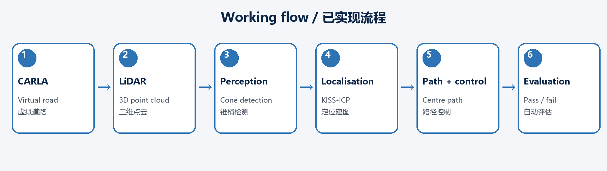

# MotorSport — LiDAR Autonomy Stack / 激光雷达自动驾驶栈

A bilingual LiDAR perception, localization, planning, and control stack built
for a Formula SAE Autonomous (FSAE-AV) driverless pipeline. It runs CARLA
(Windows) as the sensor/vehicle simulator and ROS 2 (Ubuntu/WSL) for
perception, mapping, and control, and is also validated against public
real-world LiDAR data.

一个面向 FSAE 无人赛车（FSAE-AV）驾驶管线的中英双语激光雷达感知、定位、
规划与控制系统。仿真侧使用 Windows 上的 CARLA 提供传感器与车辆模型，
计算侧使用 WSL 中的 ROS 2 完成感知、建图与控制，并额外用公开真实雷达数据
做了交叉验证。

This repository is a curated subset of a larger, ongoing team project — code
and results only, without team data, raw experiment logs, or internal
tracking documents.

本仓库是一个更大的、仍在推进中的团队项目的精选子集，只包含代码与结果，
不含团队数据、原始实验日志或内部跟踪文档。

## Pipeline / 系统流程



1. **Perception** — cluster raw LiDAR points into cone candidates, filter by
   geometry, and track them across frames (`perception/`).<br>
   **感知**：对原始点云做聚类得到锥桶候选，按几何特征过滤，并逐帧跟踪
   （`perception/`）。
2. **Mapping & localization** — merge stable cone detections into a bounded
   local/global landmark map; correct odometry drift against live LiDAR
   landmark matches (`ros2_ws/src/motorsport_lidar_bridge/motorsport_lidar_bridge/localization.py`).<br>
   **建图与定位**：把稳定的锥桶检测合并为有界局部/全局地标地图，用实时
   雷达地标匹配校正里程计漂移。
3. **Planning** — pair left/right cones into a centre path, curve-aware for
   non-straight sections (`.../path_planning.py`, `.../closed_track.py`).<br>
   **路径规划**：将左右锥桶配对为中心路径，弯道段自适应处理。
4. **Control** — pure-pursuit path following with a bounded dynamic-obstacle
   safety override (`.../path_controller.py`, `.../robustness.py`).<br>
   **控制**：纯追踪路径跟随，叠加有界的动态障碍安全覆盖层。

## Layout / 目录结构

| Path | Contents |
|---|---|
| `ros2_ws/src/motorsport_lidar_bridge/` | ROS 2 package: CARLA↔ROS 2 bridge, localization, planning, control, and unit tests |
| `perception/` | Standalone CARLA LiDAR cone detection and visualization scripts |
| `evaluation/` | Reproducible evaluators for each milestone (path integration, closed-loop laps, live CARLA integration, robustness, public/RTK trajectory accuracy) |
| `results/` | Final metrics for each milestone (JSON) |
| `assets/` | Pipeline diagram, RViz/CARLA screenshots, trajectory comparison plots |
| [`MotorSport_Technical_Summary_Report_Bilingual.docx`](MotorSport_Technical_Summary_Report_Bilingual.docx) | Bilingual technical summary report covering completed work, results, and limitations |

## Results / 结果

| Milestone | Setup | Result |
|---|---|---|
| Public LiDAR odometry (KISS-ICP) | VLP-16 public dataset vs. RTK ground truth | Fixed-RTK ATE RMSE 2.132 m, 1 s RPE RMSE 0.660 m |
| H3 — path following | CARLA dynamics closed loop | Mean cross-track error 0.293 m |
| H4 — closed-loop lap | Prebuilt landmark map, injected drift, live correction | Full lap completed, all acceptance checks passed |
| H5 — robustness matrix | 8 deterministic scenarios (dropout / noise / obstacles) | 8/8 scenarios, 24/24 target laps, worst P95 cross-track error 0.531 m |
| H5 — live CARLA circle | 3 laps | Mean/P95 cross-track error 0.084 / 0.168 m |
| H5 — live CARLA oval | 1 lap | Mean/P95 cross-track error 0.246 / 0.558 m |

Trajectory comparison plots are in `assets/`.

## Stack / 技术栈

CARLA 0.9.16 · ROS 2 (Jazzy) · RViz2 · Python · KISS-ICP v1.3.0 · pytest / `ament` unit tests

## Running it / 运行方式

The ROS 2 package builds like any standard `ament_python` package:

```bash
colcon build --packages-select motorsport_lidar_bridge
```

Each script under `evaluation/` is a standalone entry point — see its
docstring for required inputs. `evaluation/run_h5_robustness.py` runs fully
offline against a deterministic scenario matrix and needs neither CARLA nor
ROS 2.

`evaluation/` 下的每个脚本都是独立入口，具体所需输入见各自 docstring。
`evaluation/run_h5_robustness.py` 可完全离线运行确定性场景矩阵，不依赖
CARLA 或 ROS 2。
