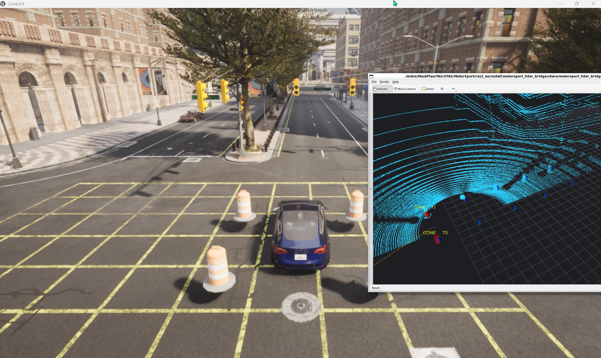
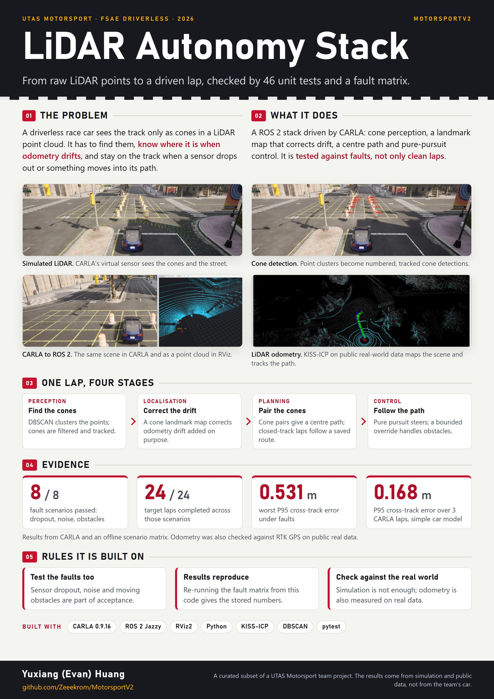
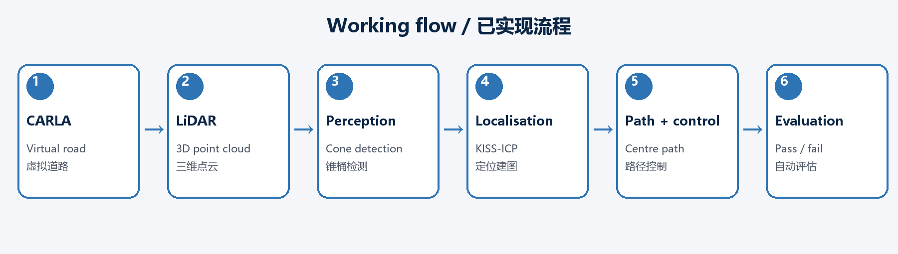
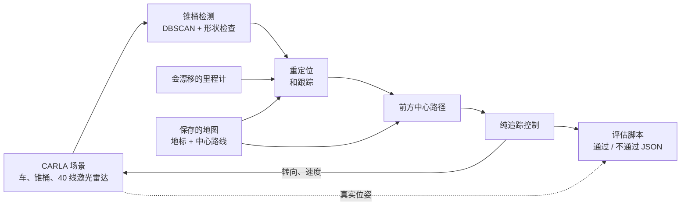
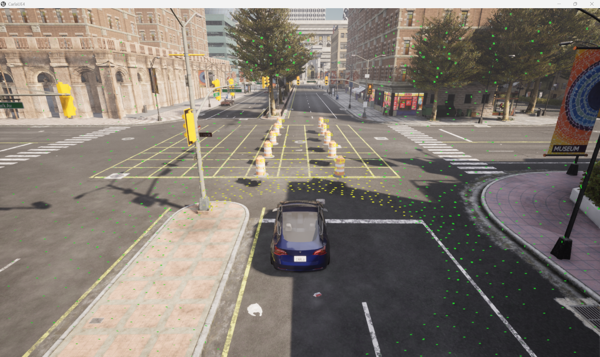
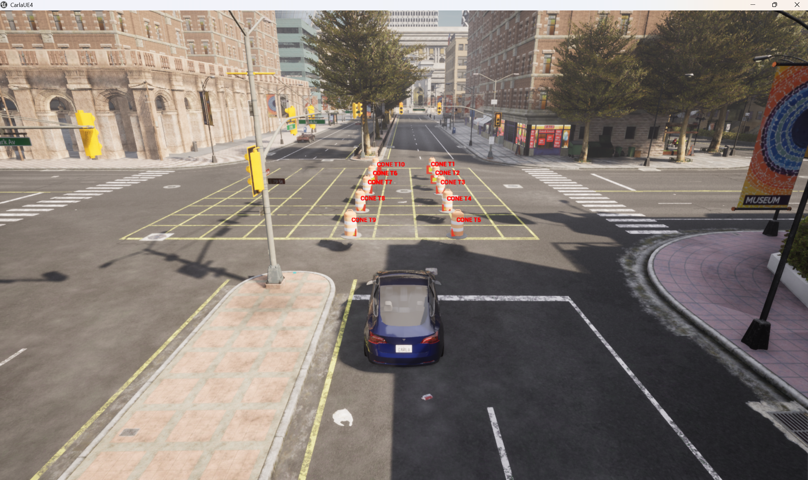
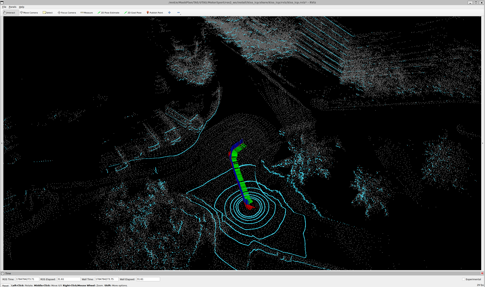
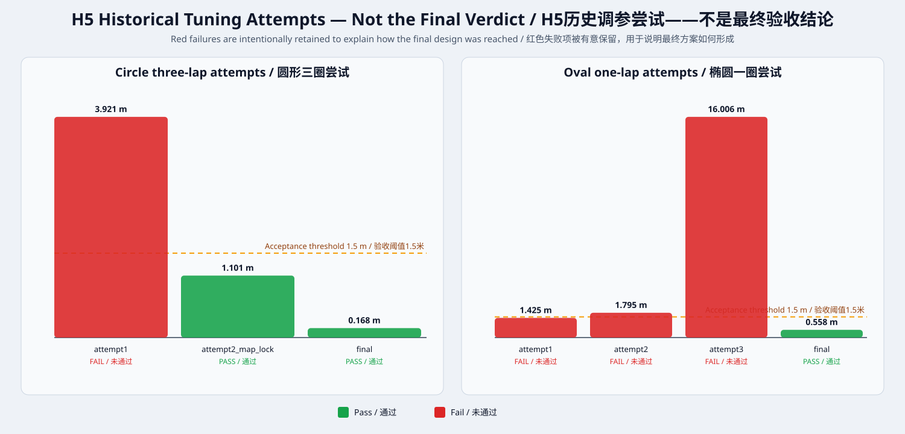
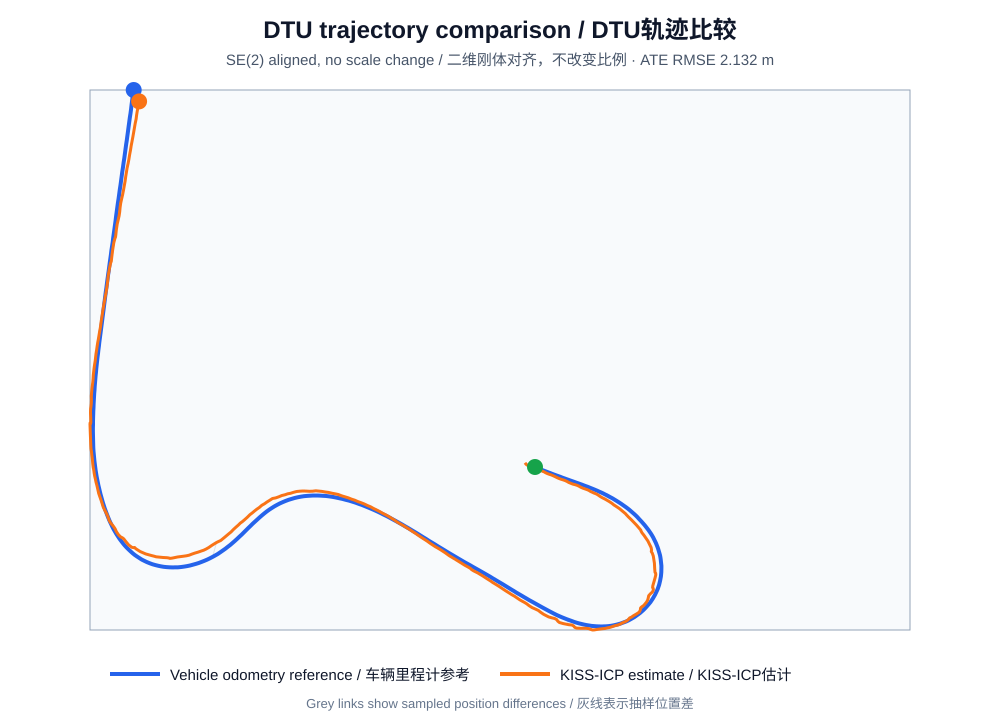

# MotorSport LiDAR Autonomy Stack

[English](README.md) · **简体中文**


MotorSport 是一套面向 FSAE 无人赛车（FSAE-AV）的激光雷达感知、定位、规划与控制系统。CARLA 里一台虚拟 40 线激光雷达扫描一条用锥桶标出的赛道。系统找出锥桶，逐帧跟住它们，用锥桶地图校正车的位置，沿赛道中间生成一条路径，再让车沿着它转向行驶。

它在仿真和公开真实数据上都做了检查。CARLA 0.9.16 跑在 Windows 上，ROS 2 Jazzy 和 RViz2 跑在 WSL 2 里。H1 到 H5 每个阶段都按写明的通过/不通过标准打分。另外，用公开的 DTU Roadrunners 数据集（Velodyne VLP-16），把 KISS-ICP v1.3.0 激光雷达里程计和独立的 RTK GPS 做了比较。

它来自 UTAS Motorsport（塔斯马尼亚大学）的无人驾驶项目，我在里面做激光雷达感知和自动驾驶系统。项目早期的文档把计划分成两半：先在仿真里做软件，再上真实硬件。本仓库里的双语报告是我对前一半工作的说明：把那些文档里分散的步骤连成一套能运行、能测试的软件流程。它不是一辆能上赛道的车。这里的东西都没有在团队的车、团队的 Pandar40P 激光雷达或真实锥桶赛道上跑过。

本仓库是一个更大的、仍在推进中的团队项目的精选子集：只有代码和结果，不含团队数据、原始实验日志或内部跟踪文档。里面有 ROS 2 功能包及其单元测试、独立的感知脚本、各阶段的评估脚本、最终结果文件、图片和技术报告。它不是团队的完整代码库。

<table>
<tr>
<td><a href="assets/figure_05_carla_rviz_bridge.png"></a></td>
<td><a href="assets/poster.jpg"></a></td>
</tr>
<tr>
<td align="center"><a href="assets/figure_05_carla_rviz_bridge.png">CARLA 和 RViz2 并排</a></td>
<td align="center"><a href="assets/poster.jpg">一页海报</a></td>
</tr>
</table>

**技术报告：** [MotorSport_Technical_Summary_Report_Bilingual.docx](MotorSport_Technical_Summary_Report_Bilingual.docx)
——一份中英双语的 Word 报告，写了完成了什么、结果、怎样核对这些工作，以及还没做完的部分。约 96 MB。



报告里的已实现流程。CARLA 提供道路和车，激光雷达给出三维点云，感知找出锥桶，定位算出车在哪里，路径与控制沿赛道中线行驶，评估脚本给每次运行判通过或不通过。在 CARLA 闭环里，定位用的是锥桶地标重定位；KISS-ICP 是单独在公开真实数据上测试的。

## 目录

- [一眼看懂](#一眼看懂)
- [要解决的问题](#要解决的问题)
- [给谁用](#给谁用)
- [一圈从头到尾](#一圈从头到尾)
- [图片](#图片)
- [现在已经做到的](#现在已经做到的)
- [设计原则](#设计原则)
- [仿真和公开数据里哪些是真实的](#仿真和公开数据里哪些是真实的)
- [怎么一步步做出来的](#怎么一步步做出来的)
- [出过的问题怎样变成规则](#出过的问题怎样变成规则)
- [技术栈](#技术栈)
- [验证证据](#验证证据)
- [运行方式](#运行方式)
- [还没做完的](#还没做完的)
- [这个项目说明了什么](#这个项目说明了什么)
- [权利与联系](#权利与联系)

## 一眼看懂

| | |
|---|---|
| 是什么 | 一套给 FSAE 无人赛车用的激光雷达系统：锥桶检测、跟踪、锥桶地图、重定位、中线路径规划和纯追踪控制，每个阶段都有评估脚本 |
| 给谁用 | 以后要把软件搬到真实硬件上的 UTAS Motorsport 队员，以及想弄清这些结果能说明什么、不能说明什么的人 |
| 要解决的问题 | 车只能靠锥桶认出赛道；而在能用上车、传感器和测试赛道之前，软件就得先做出来、测过 |
| 传感器 | CARLA 里的一台虚拟 40 线激光雷达（量程 50 米，10 Hz）。真实数据检查用的是公开的 Velodyne VLP-16 记录 |
| 技术栈 | Windows 上的 CARLA 0.9.16；WSL 2 中 Ubuntu 24.04 上的 ROS 2 Jazzy；RViz2；Python 加 NumPy 和 scikit-learn；KISS-ICP v1.3.0；pytest |
| 证据 | 46 个单元测试；一个确定性的 8 场景矩阵，24 圈全部跑完；实时 CARLA 运行：圆形赛道 3 圈、椭圆赛道 1 圈；KISS-ICP 对照固定解 RTK GPS 的 ATE RMSE 为 2.132 米 |
| 数据 | 只有仿真和公开数据集。没有团队数据，也没有 Pandar40P 记录 |
| 状态 | 软件与仿真阶段接近完成。硬件阶段（Pandar40P、Ellipse-D IMU、推车、真实赛道）还没完成 |

## 要解决的问题

FSAE 无人赛车跑的赛道只用锥桶标出来。它的软件每一圈都得回答这些问题：

- 哪些激光雷达点是锥桶？和刚才看到的是不是同一批锥桶？
- 里程计在漂移时，车到底在哪里？
- 赛道中线在哪里，直道上和弯道里都要找得到？
- 车能不能沿这条中线跑完一整圈，再连跑几圈？
- 锥桶漏检、位置有噪声，或者有东西挡在赛道上时，还能不能正常工作？
- 在真实传感器数据上，定位有多可信？

实体阶段需要团队的硬件和测试场地，现在还没做。所以这套系统先在仿真里回答这些问题，能用公开真实数据的地方再用真实数据，并且说清楚哪些是哪种。

## 给谁用

| 角色 | 他们需要回答的问题 | 这个仓库给他们看什么 |
|---|---|---|
| 准备硬件阶段的队员 | 软件准备好接真实的 Pandar40P 记录了吗？ | 一套在仿真和公开 VLP-16 数据上测过的系统，写明了它的局限，也列出了硬件阶段还缺什么 |
| 做感知或规划的开发者 | 每个模块做什么，怎么测？ | 锥桶几何、建图、重定位、规划、控制和故障注入的小模块，以及 46 个不需要 ROS 2 或 CARLA 就能跑的单元测试 |
| 核查结果的人 | 哪些结果来自仿真，哪些来自真实数据，怎样才算通过？ | 写明了设置和所用参照的结果文件；每个阶段的结果文件还把验收标准放在指标旁边 |

## 一圈从头到尾



1. **场景。** CARLA 在一条 4.4 米宽的闭环赛道（圆形、椭圆形或不对称的技术型赛道）上放好车和交通锥，把一台 40 线激光雷达装在 2.4 米高处，以每秒 20 帧的固定步长运行。
2. **锥桶检测。** 车前 3–25 米、左右各 4.5 米以内的点用 DBSCAN 分组。只有大小、高度和锥形都对得上的组才算锥桶：8–300 个点，宽 0.30–0.85 米，高 0.20–1.10 米。
3. **故障。** 在 H5 的实时运行里，一个固定种子的注入器去掉 15% 的锥桶候选，并加上 0.08 米的位置噪声，所以每次运行出的故障都一样。
4. **车在哪里。** 车的里程计按设定的速率漂移。看到的锥桶和保存的地标地图匹配（距离 1.8 米以内，至少匹配三个，残差超过 0.45 米的离群点丢掉），平滑后的偏移量用来校正漂移。地图只细化匹配上的锥桶，不再加入新的。
5. **跟踪。** 校正后的锥桶被跟踪。一个锥桶被检测到三次、而且最近十帧内还看得到，才算稳定锥桶输出。
6. **路径。** 保存的地图里还有中心路线，校正后的位姿从中选出前方 18 米。在直道和弯道测试场景里，路径改由左右锥桶配对生成，宽度不在 2–8 米之间的赛道会被拒绝。
7. **控制。** 纯追踪瞄准前方 5 米的点（技术型赛道是 4 米），弯越急速度越低，转向角限制在 35° 以内。没有可用路径时，指令就是停车。之后由一个确定性的自行车模型在 CARLA 里移动车辆；更早的 H3 阶段用的是 CARLA 自带的车辆物理。
8. **打分。** CARLA 的真实位姿只在这一步使用。评估脚本读取日志，数圈数，测量横向误差、航向误差和定位误差，逐项对照写明的标准，再写出一份 JSON 结果。

## 图片

| | |
|---|---|
|  |  |
| **CARLA：激光雷达点。** 虚拟 40 线激光雷达的抽样点，画进场景里，前方是十个测试锥桶 | **CARLA：锥桶检测。** 经过聚类、形状检查和跟踪之后的稳定轨迹，标为 CONE T1 到 T10 |



**RViz2：在公开数据上运行 KISS-ICP。** 回放一段公开激光雷达记录得到的局部地图和位姿轨迹，不涉及 CARLA。CARLA 与 RViz2 的桥接画面在本页开头：点云、检测到的锥桶（红色，带轨迹编号）和锥桶地图（蓝色）。

## 现在已经做到的

| 能力 | 已实现的证据 |
|---|---|
| 虚拟传感器 | CARLA 光线投射激光雷达：40 线，量程 50 米，10 Hz，装在 2.4 米高处；20 FPS 同步仿真 |
| 锥桶检测 | 感兴趣区域、DBSCAN 聚类（0.42 米），以及点数、尺寸、高度和锥形检查 |
| ROS 2 桥接 | `/carla/lidar/points`（PointCloud2）、`/detected_cones` 和 `/cone_map`（MarkerArray）、`/planned_path`（Path）、`/path_following/cmd_vel`（Twist）；一份 RViz2 配置；先在 localhost 找 CARLA，再通过 WSL 网关找 |
| 检测打分 | `moving_cone_detector.py` 把行驶中车辆的检测结果和锥桶真实位置对比打分（精确率、召回率、F1、位置误差）；`multi_speed_evaluation.py` 比较 1、2、4 m/s 下跑 30 米的结果，每种速度跑四次 |
| 地图与重定位 | 稳定锥桶合并成有界地图，60 米以外的会被删掉；锁定模式下不接收没匹配上的锥桶；根据匹配上的地标做平面平移校正，带离群点剔除和平滑 |
| 中线路径规划 | 在车辆坐标系里配对左右锥桶，适用于直道和弯道；至少两对；宽度只接受 2–8 米 |
| 闭环赛道 | 圆形、椭圆形和技术型赛道，宽 4.4 米，能跨起点线计圈 |
| 控制 | 纯追踪，弯道降速，转向角限制在 35° 以内，没有路径时发停车指令 |
| 鲁棒性 | 固定种子的锥桶漏检和位置噪声。障碍规则：8 米内开始减速，在 3 米净空前 0.3 米停车，等障碍远于 5 米才恢复；只在确定性矩阵里测过 |
| 公开数据里程计 | 在公开 VLP-16 记录上运行 KISS-ICP，并有分别对照 LeGO-LOAM 轨迹、车辆里程计和 RTK GPS 的评估脚本 |

## 设计原则

- **先仿真，后硬件。** 按项目早期文档的安排，软件先在 CARLA 里做出来、测过，再让任何真实车辆动起来。
- **一次只改一样东西。** H3 用 CARLA 的车辆物理测路径跟随。H4 换成确定性的自行车模型，这样感知、重定位、规划和控制可以单独评判。
- **位姿是估出来的，不是直接读的。** 在闭环里，规划器用的是带漂移的位姿加上地标校正。CARLA 的真实位姿只用来给这次运行打分。
- **逻辑放在 ROS 之外。** 几何、建图、重定位、规划、控制和故障注入都是普通 Python 模块，所以它们的测试不需要 ROS 2 或 CARLA。
- **出错时安全。** 没有可用路径就发停车指令。规划器至少要两对锥桶，不可能的赛道宽度直接拒绝。
- **固定种子，可重复。** 故障用固定种子，H5 矩阵是确定性的，所以一次运行可以原样重来。
- **每个阶段都有写明的标准。** H4、H5 和 RTK 的结果文件把验收标准放在指标旁边，所有检查都通过才算通过。
- **说清参照是什么。** 车辆里程计和 LeGO-LOAM 轨迹都标明不是真值。公开 VLP-16 数据从不说成 Pandar40P 数据。
- **失败也留着。** 失败的调参尝试单独放在一张图里。最终结果分开展示。

## 仿真和公开数据里哪些是真实的

| 来源 | 是什么 | 能说明什么 |
|---|---|---|
| CARLA 场景 | 虚拟城镇、交通锥和虚拟 40 线激光雷达。车由 CARLA 物理（H1–H3）或确定性自行车模型（H4、H5 实时运行）驱动 | 感知、规划和控制的逻辑。不代表真实传感器噪声或真实车辆动力学 |
| H5 矩阵 | 纯 Python 的自行车模型仿真，带固定种子的故障，不用 CARLA | 跨赛道、跨故障和障碍的可重复回归 |
| 地图与漂移 | 用已知锥桶位置预先载入的地标地图，代替一次更早的建图运行；里程计漂移按设定速率注入 | 重定位的逻辑。不是一次真实的建图运行 |
| LeGO-LOAM VLP-16 样本 | 一段很短的公开记录，和它的 LeGO-LOAM 轨迹比较 | 和另一种方法是否一致。不是真值 |
| DTU Roadrunners，2020-05-26 | 带车辆自身里程计的公开 VLP-16 记录 | 133 秒内的漂移，参照不是真值 |
| DTU Roadrunners，2020-03-11 RRC | 带 Swift Piksi Multi RTK GPS 的公开 VLP-16 记录 | KISS-ICP 对照一个独立的位置参照 |
| 团队 Pandar40P 数据 | 没有使用。当时没有团队的记录 | 暂时没有 |

数据集本身不在这个仓库里；这里只有评估脚本和结果文件。

## 怎么一步步做出来的

| 阶段 | 加了什么 |
|---|---|
| 环境与桥接 | Windows 上的 CARLA、WSL 2 里的 ROS 2 Jazzy 和 RViz2 连成一个项目；一台虚拟 40 线激光雷达；点云发送到 ROS 2 和 RViz2，并能用 rosbag 录制和回放 |
| 锥桶检测 | DBSCAN 聚类、形状检查和跨帧跟踪；车辆行驶中的测试和多速度测试 |
| H1、H2 | 从 CARLA 经 ROS 2 得到中心路径：先在直道上、对照锥桶真实位置打分，再到弯曲的局部通道 |
| H3 | 用 CARLA 车辆物理做闭环纯追踪路径跟随 |
| H4 | 在预先建好图的圆形赛道上跑完整一圈，带注入漂移、地标重定位和自行车模型 |
| 公开数据 | 在公开 VLP-16 数据上运行 KISS-ICP，分别对照 LeGO-LOAM、车辆里程计和 RTK GPS |
| H5 | 三种赛道形状、多圈、固定种子的故障、障碍停车再恢复和锁定地图；一个确定性矩阵，加上圆形和椭圆形赛道的实时 CARLA 运行 |

顺序沿用早期文档的安排：先软件和仿真，后真实硬件。报告的日期是 2026 年 7 月 18 日到 23 日，这个精选仓库在 2026 年 8 月 4 日公开。各个阶段的具体日期这里没有记录。

## 出过的问题怎样变成规则

| 问题 | 改了什么 |
|---|---|
| 没有团队的 Pandar40P 记录 | 改用公开的 VLP-16 数据测试 KISS-ICP。每个结果都写明用的哪个数据集，没有一个被说成 Pandar40P 数据 |
| 早期文档用的是 VirtualBox 里的 Ubuntu 18.04、ROS Melodic 和 LeGO-LOAM | 系统换到 WSL 2、Ubuntu 24.04、ROS 2 Jazzy 和 KISS-ICP：更新、仍有支持，也更容易用上 Windows 电脑的 GPU |
| 结果靠手动截图和终端输出保存 | 每个阶段都写出 CSV 和 JSON，带验收标准和通过或不通过 |
| 只成功一次可能是运气 | H5 加入了三种赛道形状、多圈、固定种子的传感器故障和一个动态障碍 |
| 对照记录下来的车辆里程计，KISS-ICP 的 ATE RMSE 是 12.093 米；其中一个 20 秒的片段到了 5.976 米，其他片段都在 0.305 到 0.789 米之间 | 车辆里程计不是真值，所以另找一段序列对照独立的 RTK GPS，并把固定解 RTK 窗口和混合 GPS 状态分开报告 |
| GPS 消息在测量后大约 4 秒才到达记录用的电脑 | 按 GPS 测量时间对齐位置，用 18 秒的 GPS–UTC 差换算成 UTC，而不是按接收时间 |
| 第一次实时 CARLA 圆形赛道尝试失败，P95 横向误差 3.921 米，标准是 1.5 米 | 下一次尝试锁定了预建地图，只细化匹配上的地标，不接收没匹配上的噪声锥桶；这次以 1.101 米通过，最终运行做到 0.168 米 |
| 三次实时椭圆赛道尝试失败 | 它们留在调参图里；最终运行以 0.558 米通过，单独报告 |
| CARLA 和 ROS 的坐标手性相反，转向符号也相反 | 用一个函数把 CARLA 的点转到 ROS 地图坐标系；转向从 ROS 的左正航向换算成 CARLA 的右正转向 |

## 技术栈

- Windows 上的 CARLA 0.9.16：20 FPS 同步模式和光线投射激光雷达
- WSL 2 中 Ubuntu 24.04 上的 ROS 2 Jazzy：`rclpy`、一个 `ament_python` 功能包和 RViz2 配置
- Python 加 NumPy、scikit-learn（DBSCAN）、读取 DTU 记录用的 `rosbags`，以及 pytest
- KISS-ICP v1.3.0，在同一个 ROS 2 工作区里编译

## 验证证据

ROS 2 功能包在九个文件里有 46 个单元测试（44 个测试函数，其中一个对三种赛道形状各跑一次）。它们只需要 Python、NumPy 和 pytest。2026 年 11 月 16 日核对本页时，46 个全部通过，和报告里记录的 46/46 一致。同一天用本仓库的代码重跑 H5 矩阵，结果文件里的每个指标都原样复现。

| 检查 | 设置 | 结果 | 文件 |
|---|---|---|---|
| H4 闭环一圈 | CARLA 激光雷达、圆形赛道、预建地标地图、注入漂移、自行车模型 | 1 圈；14/14 项检查通过；平均 / P95 横向误差 0.509 / 0.932 米；平均定位误差校正前 0.415 米，校正后 0.139 米 | [`h4_closed_loop_lap_evaluation.json`](results/h4_closed_loop_lap_evaluation.json) |
| H5 确定性矩阵 | 3 种赛道形状上的 8 个场景：正常、中等故障、高强度故障（35% 漏检，0.18 米噪声）和一个动态障碍；不用 CARLA | 8/8 场景，24/24 圈；最差 P95 横向误差 0.531 米；障碍场景停车 2.0 秒，最近距离 3.30 米，然后恢复 | [`h5_robustness_evaluation.json`](results/h5_robustness_evaluation.json) |
| H5 实时 CARLA 圆形 | CARLA 激光雷达、15% 锥桶漏检、0.08 米噪声、3 圈 | 3/3 圈；平均 / P95 横向误差 0.084 / 0.168 米；平均定位误差校正前 1.568 米，校正后 0.159 米 | [`h5_carla_circle_three_lap_evaluation.json`](results/h5_carla_circle_three_lap_evaluation.json) |
| H5 实时 CARLA 椭圆 | 同样的故障，1 圈 | 1/1 圈；平均 / P95 横向误差 0.246 / 0.558 米；平均定位误差校正前 0.593 米，校正后 0.121 米 | [`h5_carla_oval_one_lap_evaluation.json`](results/h5_carla_oval_one_lap_evaluation.json) |
| KISS-ICP 对照 RTK GPS | DTU RRC 序列；固定解 RTK 窗口 390 个样本、42.6 秒、312 米 | ATE RMSE 2.132 米；1 秒 RPE RMSE 0.660 米；路径长度相差 0.33% 以内；6/6 项检查通过。全部 1,879 个 GPS 样本（大部分是 SBAS）的 ATE RMSE 为 5.778 米 | [`dtu_rtk_trajectory_evaluation.json`](results/dtu_rtk_trajectory_evaluation.json) |
| KISS-ICP 对照车辆里程计 | DTU 2020-05-26 序列，133.3 秒，238 米 | ATE RMSE 12.093 米；1 秒 RPE RMSE 0.754 米。参照不是真值 | [`dtu_trajectory_evaluation.json`](results/dtu_trajectory_evaluation.json) |
| KISS-ICP 对照 LeGO-LOAM | 公开 VLP-16 样本，10.6 秒内 86 个样本 | 均方根差 0.077 米。参照不是真值 | [`public_trajectory_evaluation.json`](results/public_trajectory_evaluation.json) |

| | |
|---|---|
|  |  |
| **H5 调参历史。** 每次实时 CARLA 尝试的 P95 横向误差，包括失败的。最终运行就是上表里的那几次 | **KISS-ICP 对照固定解 RTK GPS。** 参照线是 RTK GPS 轨迹；图例沿用了第一张 DTU 图的“车辆里程计参考”标签 |

CARLA 的数字是仿真结果：漂移是注入的，地图是用已知锥桶位置建的，H4 和 H5 还用自行车模型代替了车辆物理。它们检验的是软件逻辑，不是真车的表现。其他图见 [`dtu_rtk_full_gps_comparison.svg`](assets/dtu_rtk_full_gps_comparison.svg) 和 [`dtu_trajectory_comparison.svg`](assets/dtu_trajectory_comparison.svg)。

## 运行方式

ROS 2 功能包和任何标准 `ament_python` 包一样编译：

```bash
colcon build --packages-select motorsport_lidar_bridge
source install/setup.bash
ros2 launch motorsport_lidar_bridge carla_lidar_rviz.launch.py
```

桥接节点还需要 CARLA 的 Python API、scikit-learn，以及在 2000 端口上运行的 CARLA 服务器。默认是直道、以 2 m/s 按脚本行驶、1000 帧（20 FPS 下 50 秒）。启动参数包括 `scenario`（`straight`、`curve`、`closed_loop`、`oval_loop`、`technical_loop`）、`control`（`scripted`、`path_following`）、`target_laps`、`frames`、`speed`、`cone_dropout_rate` 和 `cone_noise_std_m`。

单元测试和 H5 矩阵不需要 CARLA 或 ROS 2：

```bash
cd ros2_ws/src/motorsport_lidar_bridge
python -m pytest test
python -c "from motorsport_lidar_bridge.h5_benchmark import default_scenarios, evaluate_matrix; print(evaluate_matrix(default_scenarios())[1]['aggregate_metrics'])"
```

`evaluation/` 下的每个脚本都是独立入口，所需输入见各自的 docstring。`evaluation/run_h5_robustness.py` 离线运行同一个确定性矩阵，不依赖 CARLA 或 ROS 2。有些脚本会导入更大项目里的小工具模块，这些模块没有放进来：`bilingual_console`（感知脚本和 `multi_speed_evaluation.py`）、`experiment_registry`（`run_h5_robustness.py` 和 `evaluate_h5_carla_integration.py`）以及 `export_bilingual_reports`（`evaluate_dtu_rtk_trajectory.py`）。评估脚本还需要不在本仓库里的日志和数据集。

## 还没做完的

报告把软件阶段和硬件阶段分开说明：软件阶段接近完成，硬件阶段没有。报告还记录了 Hesai 官方 ROS 2 驱动已在 ROS 2 Jazzy 上编译并短时间启动过，为以后录制 Pandar40P 数据做好了准备；这部分不在本仓库里。

| 还要做的 | 状态 | 需要什么 |
|---|---|---|
| 实体 Pandar40P 数据 | 还没测试 | 一份经过许可的 PCAP 或 bag 文件、修正文件和传感器设置 |
| Ellipse-D IMU 融合 | 还没完成 | IMU 本身、标定、时间对齐和记录下来的数据 |
| 推车安装 | 还没完成 | 推车、传感器支架、电源、网络和安全检查 |
| 真实锥桶赛道测试 | 还没完成 | 测试场地许可、锥桶、实体传感器和用来对照的真值 |
| 实体车辆控制 | 不在已测试的工作范围内 | 车辆接口、安全系统和获批的测试方案 |

软件本身也有局限。KISS-ICP 不在 CARLA 闭环里；闭环里的定位是只做平移的地标重定位，用的地图是按已知锥桶位置建的。在闭环赛道上，车跟的是保存的中心路线；实时的锥桶配对规划只用在直道和弯道场景。障碍安全规则和技术型赛道只在确定性矩阵里测过，没有在实时 CARLA 里跑过。H3 的结果文件、上面提到的工具模块和测试启动脚本都留在更大的项目里。

照报告的说法，下一步最有价值的不是继续调 CARLA 参数，而是拿到一份真实的 Pandar40P 记录和它的标定文件，通过已经检查过的驱动回放，再和当前的软件结果作为基线比较。

## 这个项目说明了什么

- 把工作分成阶段、每个阶段都有写明的标准，出错时很容易定位。
- 参照和方法一样重要。车辆里程计和另一种方法的轨迹都不是真值；独立的 RTK GPS 才能说明 KISS-ICP 漂了多远。
- 把失败的调参运行留在记录里，能说明最终参数是怎么来的。
- 固定种子、确定性的测试可以原样重跑：H5 矩阵在结果保存三个多月后重跑，数字完全一样。
- 仿真可以为硬件阶段做准备，但不能代替它。

## 权利与联系

本仓库是一个 UTAS Motorsport 团队项目的精选子集。它没有附许可文件，所以复用其中任何内容之前请先联系我。第三方工具和数据保留它们各自的许可，包括 CARLA、ROS 2、KISS-ICP 和 DTU Roadrunners 数据集（CC BY-NC-SA 4.0）。联系方式：[LinkedIn](https://www.linkedin.com/in/evan-h-165976301/)。
